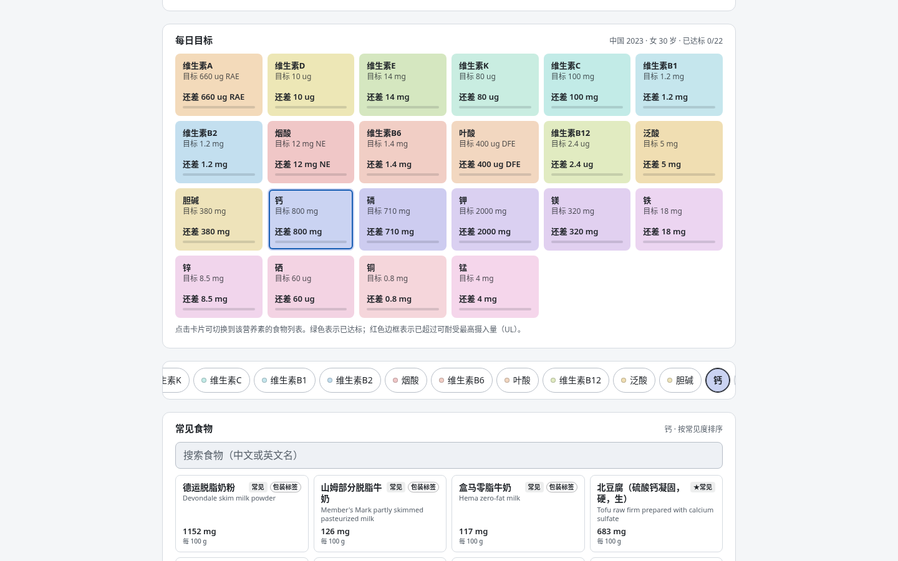
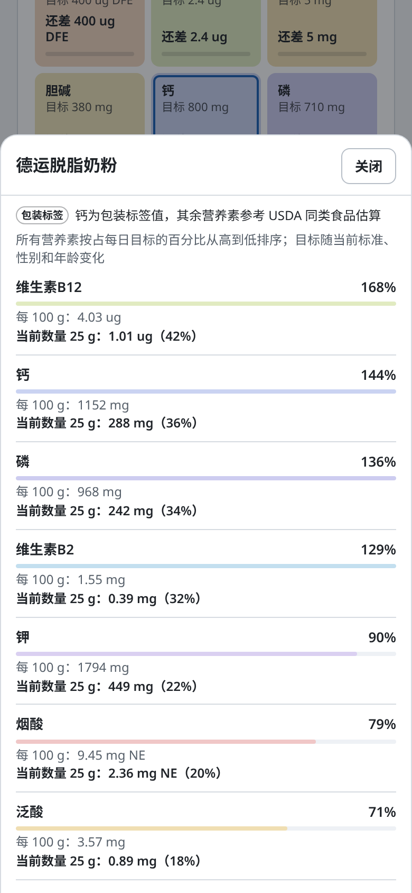

# 微量营养素追踪

一个纯静态的网页小工具：看看今天吃的食物里，22 种营养素（维生素、矿物质等）大概有多少，
再和「中国居民膳食营养素参考摄入量（2023 版）」或美国的标准比一比，知道自己还差多少。

线上地址：<https://hairrrrr.github.io/micronutrients-tracker/>





## 这个网站能做什么

- **先选自己的情况**：性别、年龄（18–100 岁）和采用哪套标准（中国 2023 / 美国）。
  中国和美国两套标准可以并排看，也可以随时切换。切换之后，每一张卡片上的目标数字和「还差多少」都会跟着变。
- **22 张目标卡片**：每张卡片是一种营养素，写着每日目标、还差多少（或超出多少），
  下面一条细进度条。达到目标时卡片变绿；超过上限（UL，简单说就是每天最多吃到这个数）时出现红色提醒。
- **22 个营养素标签页**：点一张卡片就切到对应的食物列表，看看哪些食物这种营养素多。
- **食物卡片**：中文名、英文名、每 100 克（少数按每 10 克）的含量。
  点一下卡片会原地展开成编辑框，选好份量后按「确认」才算选中；选中的食物会排到列表最前面。
- **食物详情**：展开的卡片上有「查看详情」，打开一张表，
  列出这种食物含有的每一种营养素、每 100 克的量、占每日目标的百分比，以及你选的那份量里的量。
- **家庭计量**：一碗、一杯、一把、一掌心……都是近似重量，也可以直接输入克数。
- **带骨食物**：猪排骨、鸡翅等按带骨重量称，营养只算肉的部分——先把骨头扣掉，只算肉的重量
  （可食部 = 带骨重量 ×（1 − 废弃率））。
- **包装标签食物**：这是用户自己家的三种牛奶，钙直接用包装上的数字，其他营养素参考同类食品（USDA）估算，
  默认排在钙列表最前面。
- **不需要账号，也不上传**：你的选择只存在这台设备的浏览器里，就像记在自己的笔记本上：关掉网页再打开还在，
  但换一台电脑或手机就是全新的空白记录，不会上传到任何地方（技术上叫 localStorage）。
- **手机优先**：360–390 像素宽也不会横向滚动；桌面端自动变多列。

## 数据来源与许可

| 数据 | 用在哪里 | 来源与许可 |
|---|---|---|
| USDA FoodData Central **SR Legacy（2018-04 版）** | 588 种食物的全部营养素数值 | 美国农业部，公有领域（CC0）；下载页 <https://fdc.nal.usda.gov/download-datasets> |
| 中国营养学会《中国居民膳食营养素参考摄入量（2023 版）》 | 中国标准的 RNI（简单说就是「每天建议吃到这么多」）、AI（「大概吃够就行」）和 UL（「每天最多吃到这个数」） | 中国营养学会，<https://www.cnsoc.org/drpostand/> |
| NASEM 膳食参考摄入量（经 NIH ODS 汇总） | 美国标准的 RDA（也是「每天建议吃到这么多」）、AI 和 UL | <https://ods.od.nih.gov/HealthInformation/nutrientrecommendations.aspx> |
| 家庭计量、常见度、带骨废弃率、包装标签 | `data-src/` 里逐条可查的输入 | 家庭计量来自 USDA 份量表或标注过的估算；常见度（1–5 档，档位越高越常见）是 AI 模型的估计并经人工复核；带骨废弃率取自 USDA SR28；包装标签由用户提供 |

一共 **591 种食物**（588 种来自 SR Legacy，3 种来自包装标签），**33 个分类**，
**22 种营养素**。其中 **58 种**调味料、香辛料、食用油和干货按每 10 克比较和标示，
**15 种**是带骨食物。参考摄入量表 `data-src/dri/cn2023.csv` 和 `data-src/dri/us.csv`
各有 220 行数值（10 个年龄性别组 × 22 种营养素）。

## 在本地运行

需要 Node.js 和 Python 3（只用标准库，不需要安装别的包）。

```sh
npm run serve   # 在 http://localhost:8000/ 打开网站
```

这个命令只是用 Python 起一个静态文件服务器，把 `docs/` 目录当成网站根目录。
网站没有额外的打包或编译步骤：浏览器直接打开页面、样式和脚本文件就能运行。
（想找文件的话：页面是 `docs/index.html`，样式是 `docs/css/style.css`，脚本是按模块拆开放进 `docs/js/` 的 ES 模块。）

## 测试

```sh
npm test        # 单元测试（node --test，257 个用例，不需要额外依赖）
npm run e2e     # 浏览器端到端测试（Playwright，24 个用例，用系统里已装的 Chrome）
npm run validate  # 检查 data-src/ 与 docs/data/ 的数据是否自洽
```

- `npm test` 直接导入 `docs/js/core/` 里的纯函数和 `docs/js/ui/` 里的 HTML 生成函数，
  不启动浏览器。
- 运行 `npm run e2e` 时，程序会自动打开两个临时的本地预览页面，并自动截几张图存下来，
  方便检查页面在不同情况下的样子。它自己起两个临时静态服务器：一个把 `docs/` 当网站根目录，
  另一个把仓库根目录当网站根目录，用来测放在子路径下部署的情况；截图写进 `shots/`。
  它用系统 Chrome，所以不需要另外下载浏览器。
  设置 `BASE_URL` 可以让它直接测试线上站点。
- `npm run validate` 运行 `tools/validate_data.py`：检查营养素元数据、食物行、计量、
  常见度、带骨食物、包装标签食物、生成出来的 JSON，以及 `docs/` 里没有不该出现的文字。

## 重新生成数据

网站用到的数据都是离线生成好再提交的，浏览器只负责读取：

```sh
npm run build:data   # tools/build_foods.py + tools/build_dri.py -> docs/data/*.json
npm run validate     # 生成之后再检查一遍
```

- `tools/fetch_usda.sh` 负责把 USDA 的 CSV 压缩包下载到 `data-raw/`（不提交），
  并校验 sha256。
- `tools/build_foods.py`、`tools/build_dri.py` 读取 `data-src/` 里的 CSV，写成
  `docs/data/foods.json`、`docs/data/dri.json`、`docs/data/nutrients.json` 和 `docs/data/meta.json`。
- `tools/check_values.py` 会重新读原始 CSV，抽查 `foods.json` 里的数值是否一致。

## 文件夹结构

- `docs/` — 网站本身，GitHub Pages 发布的就是这个文件夹。
  - `docs/index.html`、`docs/css/style.css`、`docs/js/app.js` — 页面、样式和入口。
  - `docs/js/core/` — 纯函数模块：`docs/js/core/dri.js`（找目标）、`docs/js/core/calc.js`（合计和状态）、
    `docs/js/core/measures.js`（份量换克数）、`docs/js/core/order.js`（排序）、
    `docs/js/core/detail.js`（详情排名）、`docs/js/core/state.js`（状态和本地存储）、
    `docs/js/core/nutrients.js`（营养素元数据）。
  - `docs/js/ui/` — 负责画面：`docs/js/ui/profile.js`、`docs/js/ui/targets.js`、`docs/js/ui/tabs.js`、
    `docs/js/ui/foods.js`、`docs/js/ui/detail.js`、`docs/js/ui/about.js`。
  - `docs/data/` — 生成好的 `foods.json`、`dri.json`、`nutrients.json`、`meta.json`。
  - `docs/vendor/` — 唯一一小段借用的 CSS 和它的许可证。
- `data-src/` — 人工或 AI 整理、提交进仓库的输入 CSV，可以逐行复核。
- `data-raw/` — 下载的 USDA 原始 CSV，比较大，不进仓库。
- `tools/` — Python 数据脚本，不随网站发布。
- `tests/unit/` — 单元测试；`tests/e2e/` — Playwright 测试。
- `shots/` — 截图。
- `documentation/` — 中文文档和图表，不会出现在网站上。

## 文档

- [`documentation/README.md`](documentation/README.md) — 文档目录和阅读顺序（第一次来建议先看这里）。
- [`documentation/ARCHITECTURE.md`](documentation/ARCHITECTURE.md) — 架构：整体结构和三张图，每个文件夹和数据文件的字段。
- [`documentation/KEY_IMPLEMENTATION.md`](documentation/KEY_IMPLEMENTATION.md) — 关键实现：目标查找、摄入合计、家庭计量与带骨换算、排序、详情排名、数据构建规则。
- [`documentation/EXPLAINED.md`](documentation/EXPLAINED.md) — 入门讲解：写给没写过代码的人，用真实数字走一遍从点击食物到卡片出数的过程。
- [`documentation/GLOSSARY.md`](documentation/GLOSSARY.md) — 术语表：DRI（简单说就是「每天大概该吃多少」的官方参考数字）、RNI、AI、UL、RAE、NE、常见度、包装标签等词的含义。
- [`documentation/diagrams/`](documentation/diagrams/) — 图表的 `.dot` 源文件和渲染出来的 `.svg`，用 `npm run docs:diagrams` 重新生成。
- 改完文档可以运行 `npm run docs:check`，检查所有相对链接和写到的文件路径是否还存在。

## 致谢

界面上的交互和排版参考了一些采用宽松许可证的开源项目，而不是从零发明。
借用的代码都很小，直接放在 `docs/` 里（不引用 CDN，也不增加运行时依赖），下面逐项说明。

- **Pico CSS v2** — <https://picocss.com> — MIT 许可证，Copyright (c) 2019-2024 Pico。
  `docs/vendor/pico-segmented.css` 是 Pico 的 `[role=group]` 行内分组布局的一小段改写，
  用于性别切换控件（改名为 `.segmented`，Pico 的自定义属性换成本项目的变量，未用到的规则已删）。
  许可证原文放在旁边：`docs/vendor/pico-segmented.LICENSE.md`。
  `docs/css/style.css` 里成组的表单行和普通输入框样式也沿用了同样的 Pico 思路，是手写的。
- **Open Props** — <https://open-props.style> — MIT 许可证。
  设计变量的做法（一个 `:root` 里放 `--surface`、`--border`、`--radius`、`--pad` 等自定义属性）
  参考了 Open Props 的想法，具体数值是我们自己的。
  目标卡片的网格（`repeat(n, minmax(0, 1fr))` 加 `min-width: 0`，防止长中文名撑宽一列）
  和 4 像素圆角的进度条也是同样的工具类思路，在 `docs/css/style.css` 里手写实现；
  没有放入也没有请求任何 Open Props 文件。
- **Cronometer** — <https://cronometer.com> — 仅作设计参考，未复制代码（该站不开源，所以没有放入任何文件）。
  `docs/js/ui/targets.js` 和 `docs/css/style.css` 里的目标卡片沿用了常见的营养追踪器做法：
  紧凑的目标/营养素卡片网格，写着名称、目标、还差或超出的量，下面一条细进度条。
  标记和 CSS 都是为本项目从零写的。
- **Cronometer / MyFitnessPal** — <https://cronometer.com> 和 <https://www.myfitnesspal.com> —
  仅作设计参考，未复制代码（两个站都不开源）。`docs/js/ui/tabs.js` 的营养素标签行和
  `docs/js/ui/foods.js` 的食物卡片网格，参考了常见布局：上方一行可横向滚动的营养素标签，
  下面是密集的食物网格，每张卡片一个名称、一个小一号的次要名称和一个数字。
  标记、CSS 以及手机 2 列 / 桌面 4 列的网格都是在 `docs/css/style.css` 里从零写的，
  和目标卡片一样用 `repeat(n, minmax(0, 1fr))` 这个手写思路。
- **Cronometer / USDA FoodData Central 文档页** — <https://cronometer.com> 和 <https://fdc.nal.usda.gov> —
  仅作设计参考，未复制代码（两者都不是开源代码库）。`docs/js/ui/about.js` 和
  `docs/css/style.css` 里的数据来源区块，参考了营养追踪器和数据集文档常见的
  「来源—说明—免责声明」页脚：一个标题、每个来源一张卡片（名称、一行说明、外链和纯文本 URL），
  然后是几段简短说明和最后的免责声明框。标记和 CSS 都是手写的；那些网址只是普通链接，运行时不会去请求。
- **Cronometer / MyFitnessPal / Lose It!** — <https://cronometer.com>、
  <https://www.myfitnesspal.com> 和 <https://www.loseit.com> — 仅作设计参考，未复制代码（三者都不开源）。
  `docs/js/ui/foods.js` 和 `docs/css/style.css` 里选中的食物卡片和份量编辑器，
  参考了常见做法：已记录的食物卡片变绿，下面跟一个内嵌的份量编辑器——
  份量下拉框、以半步进位的 `-` / `+` 数量按钮，以及换算出来的克数。
  标记是手写的；编辑器是卡片按钮的兄弟元素，所以在里面点任何地方都不会把卡片切换掉。
- **Pico CSS v2** — <https://picocss.com> — MIT 许可证，Copyright (c) 2019-2024 Pico。
  `docs/js/ui/foods.js` 和 `docs/css/style.css` 里的「原地展开编辑器」沿用了本项目其他地方
  已经手写的 Pico 表单和按钮思路（38 像素的控件高度、去掉原生外观的 `<select>`、扁平的描边按钮），
  用在份量下拉框和「确认 / 取消选择 / 取消」这一行上。
  展开这个交互本身——占满整行的格子、右上角的圆形对勾按钮、只有按下确认才真正生效的草稿状态——
  是为本项目从零写的；除了上面致谢的 `docs/vendor/pico-segmented.css`，没有放入或请求别的文件。
- **WAI-ARIA 创作实践（APG），disclosure 与 button 模式** — <https://www.w3.org/WAI/ARIA/apg/> —
  W3C 文档（不是代码），作为 `aria-expanded` / `aria-pressed` 这一对属性以及可展开食物格子的
  焦点处理的设计参考；标记和行为都是我们自己的。
- **Pico CSS v2 / Open Props（手机细节）** — <https://picocss.com> 和 <https://open-props.style> — MIT 许可证。
  `docs/css/style.css` 里的手机适配（38–40 像素的点击目标、16 像素的输入框让 iOS Safari 聚焦时不放大、
  用 `max(48px, calc(24px + env(safe-area-inset-bottom)))` 留出底部安全距离）也是同样的手写工具类思路，
  没有放入或请求任何文件。
- **Pico CSS v2（模态框）** — <https://picocss.com> — MIT 许可证，Copyright (c) 2019-2024 Pico。
  `docs/js/ui/detail.js` 和 `docs/css/style.css` 里的食物详情沿用 Pico 的模态框做法：
  一个原生 `<dialog>` 用 `showModal()` 打开（进入顶层、原生 Esc 关闭、`::backdrop` 变暗），
  而不是自己写一层遮罩。底部抽屉 / 居中对话框的皮肤、营养素行和焦点归位是为本项目从零写的；
  没有放入或请求任何文件。

## 免责声明

本站仅供一般信息参考，不构成医疗建议。家庭计量只是近似值；食物列表不收做好的菜肴。
肉类、蛋类、鱼和海鲜只保留生的数据，没有熟菜；米饭、蔬菜等既有生的条目，
也有煮熟的条目。带骨食物按带骨重量记录，营养素按可食部计算（重量 ×（1 − 废弃率））。
如有健康问题或特殊饮食需求，请咨询医生或注册营养师。

遇到不认识的词，随时打开术语表（[`documentation/GLOSSARY.md`](documentation/GLOSSARY.md)）查一下。
