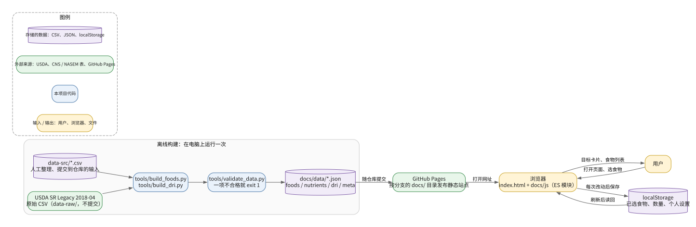
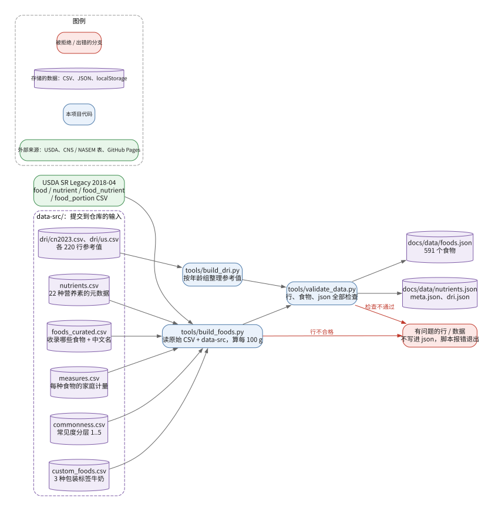
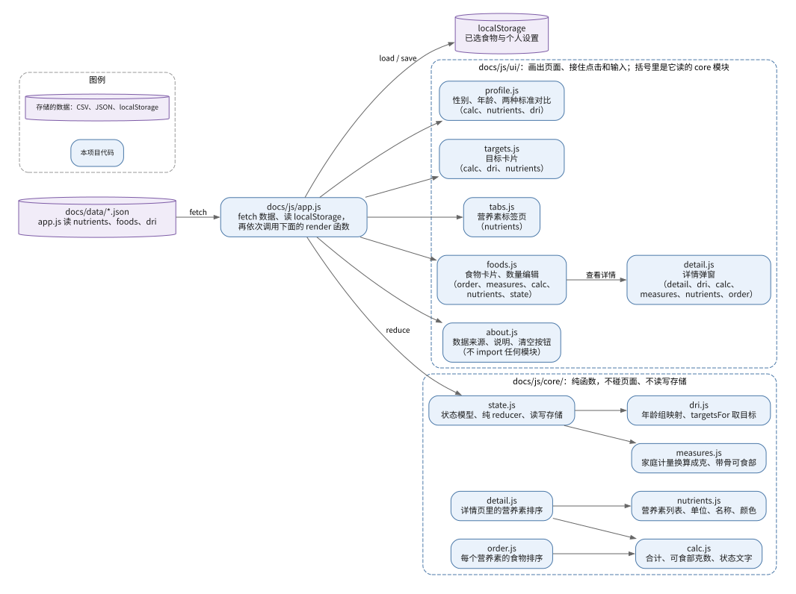

# 架构

这篇文档讲整个项目是怎么拼起来的：数据从哪里来、怎么变成网站读的 JSON、浏览器里有哪些代码、
用户的选择存在哪里、以及网站是怎么发布出去的。第一次接触这个项目，可以按
[`README.md`](README.md) 里的阅读顺序来，遇到不认识的词查 [`GLOSSARY.md`](GLOSSARY.md)。

白话版：所有营养数字都是提前在电脑上算好、存成文件的。网站放上 GitHub 后就能访问。
你打开网页时，浏览器只是读这些文件、算一下今天吃了多少、画成页面。你选的食物只存在你自己的浏览器里，
不会上传，也不需要注册账号。

一句话概括：数据在电脑上离线算好，写成 `docs/data/*.json` 提交进仓库；
GitHub Pages 把 `docs/` 当成网站发布；浏览器只负责读 JSON、算总数、画页面，
把所有选择存在自己的浏览器里（`localStorage`）。没有服务器，没有账号，也没有构建步骤。

**图的颜色和图例是一致的**：黄色 `#FFF4D6` / `#C9A227` 表示输入和输出（用户、浏览器、你看到的文件），
蓝色 `#EAF2FB` / `#4A78A8` 表示本项目自己的代码，绿色 `#E8F6EA` / `#3C8D4F` 表示外部来源
（USDA、CNS / NASEM 表、GitHub Pages），红色 `#FCE8E6` / `#C0392B` 表示被拒绝或出错的分支，
紫色圆柱 `#F1ECF8` / `#7D5BA6` 表示存下来的数据（CSV、JSON、localStorage）。
图都由 `documentation/diagrams/build.mjs` 生成，改了图要运行 `npm run docs:diagrams`。

## 一、整体结构



**图解：先在电脑上把数据算好并提交，网站只是读这些文件；用户的每一次选择都只保存在自己的浏览器里。**

- 左边是离线构建：`tools/build_foods.py` 和 `tools/build_dri.py` 读 `data-raw/` 里的 USDA 原始 CSV 和
  `data-src/` 里的整理表，写出 `docs/data/*.json`，再由 `tools/validate_data.py` 检查。
- 中间是发布：JSON 跟着仓库一起提交，GitHub Pages 直接发布 `docs/` 文件夹，没有构建步骤。
- 右边是使用：`docs/index.html` 加 `docs/js/` 里的 ES 模块在浏览器里运行，每次改动后由
  `docs/js/core/state.js` 的 `save()` 写进 localStorage，刷新时用 `load()` 读回来。

## 二、数据是怎么造出来的



**图解：所有数字都来自原始表格。脚本只负责整理和换算，不会自己编数字。如果某一行有问题，脚本会直接报错停下来，坏数据不会被写进网站文件。**

- 营养数值只有一个来源：USDA FoodData Central SR Legacy（2018-04 版）的 CSV，下载到 `data-raw/`
  （这个文件夹不进仓库）。`data-src/` 里则记着「收录哪些食物」「家庭计量」「常见度（1–5 档，档位越高越常见）」「带骨废弃率」
  「包装标签」这些人工或 AI 整理、可以逐行复核的输入。其中包装标签食物就是用户自己家的三种牛奶，
  钙直接用包装上的数字，其他营养素参考同类食品（USDA）估算。
- `tools/build_foods.py` 读原始 CSV 和 `data-src/*.csv`，算出每 100 g 的数值、四舍五入到最多 4 位有效数字，
  写成 `docs/data/foods.json`；`tools/build_dri.py` 把 `data-src/dri/cn2023.csv`、`data-src/dri/us.csv`
  按年龄性别组整理成 `docs/data/dri.json`。
- `tools/validate_data.py` 再检查一遍（食物行、计量、常见度、带骨、包装标签、生成的 JSON 等），
  任何一项不合格就 `exit 1`，坏数据不会被提交，也就不会上网站。
- 想亲手跑一遍：`npm run build:data` 生成数据，`npm run validate` 检查；`tools/check_values.py`
  还会从原始 CSV 重新抽查若干食物的数值是否和 `docs/data/foods.json` 一致。

### 生成出来的四个数据文件

都在 `docs/data/` 下，全部是 JSON。`docs/js/app.js` 里的 `DATA_FILES` 只 `fetch` 其中三个
（`nutrients`、`foods`、`dri`），`docs/data/meta.json` 是给人和脚本核对用的，页面不读它。

| 文件 | 里面是什么 |
|---|---|
| `docs/data/foods.json` | 全部食物。顶层是 `source`（数据集名称、版本、下载地址、sha256）和 `foods`（数组）。现在 591 个食物：588 个来自 SR Legacy，3 个来自包装标签。 |
| `docs/data/nutrients.json` | 22 种营养素的元数据：`id`、中英文名、单位、对应的 USDA 营养素编号、卡片颜色、`kind`（`vitamin` 或 `mineral`）。页面上的标签、单位、颜色都从这里来。 |
| `docs/data/dri.json` | 两套参考摄入量。`standards` 下的 `cn2023` 和 `us` 各 10 个年龄性别组，每组 22 个数值，一共 220 个数值格。 |
| `docs/data/meta.json` | 构建日期、生成脚本、数量统计（`counts`）和几条说明（`notes`），方便核对这批数据是怎么来的。 |

### 一个食物对象长什么样

`docs/data/foods.json` 的 `foods` 数组里，每个元素就是一个食物。下面是真实的一条（`per100g` 里省掉了大部分营养素）：

```json
{
  "id": "fdc:167853",
  "fdcId": 167853,
  "nameZh": "猪排骨（生）",
  "nameEn": "Pork fresh spareribs separable lean and fat raw",
  "usdaDescription": "Pork, fresh, spareribs, separable lean and fat, raw",
  "category": "畜肉类",
  "aliases": ["排骨", "肋排"],
  "per100g": { "vitA": 0, "calcium": 15, "iron": 0.91, "zinc": 2.5 },
  "flags": { "niacinNoTryptophan": false },
  "measures": [
    {
      "id": "palm",
      "labelZh": "一掌心大小（带骨）",
      "grams": 142.9,
      "basis": "estimate:palm-sized portion of meat or fish, about 100 g; with bone: 100 g edible / (1 - 30% refuse) = 142.9 g with bone",
      "default": true
    }
  ],
  "commonness": 5,
  "amountBasisG": 100,
  "refusePct": 30.0,
  "refuseNote": "按带骨重量计，可食部约 70%（USDA 废弃率 30%：骨）"
}
```

各字段的意思：

| 字段 | 含义 |
|---|---|
| `id` | 站内唯一编号。SR Legacy 的食物写成 `fdc:<fdcId>`，自己加的包装标签食物写成 `custom:<名字>`。 |
| `fdcId` | USDA 的数字编号；包装标签食物是 `null`，因为它们不在 USDA 表里。 |
| `nameZh` / `nameEn` | 页面上显示的中文名和英文名。 |
| `usdaDescription` | USDA 原始描述，用来核对是哪种食物；包装标签食物是 `null`。 |
| `category` | 中文分类，33 个分类之一，例如 `畜肉类`、`叶菜类`、`奶类`。 |
| `aliases` | 搜索用的别名，例如「排骨」「肋排」。 |
| `per100g` | 22 个营养素的每 100 g 含量，键就是 `docs/data/nutrients.json` 里的营养素 `id`（如 `vitA`、`calcium`）。`null` 表示原始表里没有这个值：计入总量时算 0，也不会出现在该营养素的列表里。数值是**可食部**的每 100 g。 |
| `flags` | 构建时记下的小提示。目前只有 `niacinNoTryptophan`：烟酸的色氨酸数据缺失、只能用烟酸本身计算时为 `true`。 |
| `measures` | 家庭计量，至少一条，恰好一条 `default: true`。每条有 `id`、`labelZh`（如「一杯」）、`grams`（这条计量合多少克）、`basis`（`usda_portion:<编号>` 来自 USDA 份量表，`estimate:` 是估算，`label:` 来自包装标签）、`default`。全部食物加起来有 1092 条计量。 |
| `commonness` | 常见度（1–5 档，档位越高越常见）：5 是各地都常见的主食，1 是少见的进口或专门食材。由 AI 模型估计、人工复核，不是官方分级。列表默认先按它排序。 |
| `amountBasisG` | 比较基准克数，只有 10 或 100。调味料、香辛料、食用油和干货吃得少，按 10 g 比较并标示「每 10 g」（现在 58 个）；其余食物是 100，标示「每 100 g」。`per100g` 本身永远是每 100 g。 |
| `refusePct` | 只有带骨食物（现在 15 个）才有：不可食部分（骨头）的百分比。卡片上称的是带骨重量，但营养只在肉里，所以先把骨头扣掉，只算肉的重量，营养按「带骨克数 ×（1 − 废弃率）」的可食部计算。 |
| `refuseNote` | 带骨食物的那一句中文说明，例如「可食部约 70%」。 |
| `source` | 只有 3 个包装标签食物才有：`type` 是 `package_label`，`baseFdcId` 是参考的 USDA 同类食物，`estimated` 列出哪些营养素是从同类食物估算的（钙用包装标签值，其余按同类食物估算）。SR Legacy 的食物没有这个字段。 |
| `pinTop` | 只有 3 个包装标签牛奶才有，值是 `["calcium"]`：在钙标签页里，它们排在普通排序之前。 |

### `docs/data/dri.json` 的字段

```json
{
  "buildDate": "2026-11-18",
  "generator": "tools/build_dri.py",
  "standards": {
    "cn2023": {
      "label": "中国居民膳食营养素参考摄入量（2023版）",
      "source": "……",
      "note": "……",
      "groups": [
        {
          "id": "cn-m-18-29",
          "sex": "male",
          "ageMin": 18,
          "ageMax": 29,
          "lifeStage": "none",
          "values": {
            "vitA": { "target": 770, "type": "RNI", "ul": 3000, "ulAppliesToFood": false, "ulNote": "……", "ref": "……" }
          }
        }
      ]
    },
    "us": { "……": "同样的结构" }
  }
}
```

- `standards` 下有两套：`cn2023`（中国，10 个组，从 18–29 一直到 75 岁以上）和 `us`（美国，10 个组，
  从 14–18 一直到 71 岁以上）。每组的 `values` 里有 22 个营养素，所以每套是 220 个数值格。
- 每个数值有 `target`（每日目标）、`type`（`RNI` / `AI`，美国用 `RDA` / `AI`）、`ul`（上限，可能为 `null`）、
  `ulAppliesToFood`（上限是否适用于普通食物，不是的话就不提醒）、`ulNote`（说明，可能为 `null`）
  和 `ref`（这一格来自哪张官方表）。页面用 `docs/js/core/dri.js` 的 `targetsFor()` 取出当前这套。
- 这里的数字只能来自官方表格、由人填写核对；脚本从不自己推算，也不知道该填多少。

### `docs/data/nutrients.json` 和 `docs/data/meta.json` 的字段

- `docs/data/nutrients.json`：顶层是 `source` 和 `nutrients`。每个营养素是 `id`、`nameZh`、`nameEn`、`unit`
  （如 `ug RAE`、`mg NE`）、`usdaNutrientIds`（对应 USDA 的营养素编号，烟酸是两个：烟酸加色氨酸）、
  `color`（卡片底色）、`kind`（`vitamin` 或 `mineral`）、`note`（单位说明，可能为 `null`）。
  现在 22 个：13 个维生素、9 个矿物质。
- `docs/data/meta.json`：`source`（同 `docs/data/foods.json`）、`buildDate`、`generator`、
  `counts`（`foods` 591、`srLegacyFoods` 588、`customFoods` 3、`boneInFoods` 15、`nutrients` 22）、
  `measures`，以及 `notes`：几条用英文写的构建说明，讲清 `null`、四舍五入、烟酸当量、常见度、
  `amountBasisG`、带骨和包装标签食物各是怎么处理的。

## 三、浏览器里的代码



**图解：`docs/js/app.js` 是唯一入口，它读数据、读存档，然后调用 `docs/js/ui/` 里各块的渲染函数；`docs/js/core/` 只放不碰页面的纯函数。**

- `docs/js/app.js`：页面启动时，先把三个数据文件读进来，再把你之前选过的食物从浏览器里读回来，
  然后把这些信息交给负责画卡片和列表的部分。它用相对的 `fetch` 读三个 JSON，用 `load()` 恢复存档，把数据、状态和
  一个 `onChange` 回调打包成 `context`，交给下面几个渲染函数。任何改动都走
  「事件 → `docs/js/core/state.js` 的 reducer → `save()` → 重新渲染」这一条路。只改选择时（`SELECTION_ACTIONS`），
  只重画目标卡片和食物列表，不去动正在输入的编辑框。
- `docs/js/ui/`：负责画面和事件。`docs/js/ui/profile.js`（性别、年龄、标准）、`docs/js/ui/targets.js`
  （目标卡片）、`docs/js/ui/tabs.js`（营养素标签）、`docs/js/ui/foods.js`（食物卡片和展开的编辑框）、
  `docs/js/ui/detail.js`（「查看详情」弹窗，`openDetail()`）、`docs/js/ui/about.js`（数据来源和说明）。
- `docs/js/core/`：纯函数，不碰 DOM、不直接读写 localStorage，所以 `node --test` 能直接 import。
  `docs/js/core/dri.js` 找年龄组和目标，`docs/js/core/calc.js` 算合计和卡片状态，
  `docs/js/core/measures.js` 把家庭计量换成克并处理带骨可食部，`docs/js/core/order.js` 排食物列表，
  `docs/js/core/detail.js` 排详情里的营养素，`docs/js/core/nutrients.js` 管营养素元数据，
  `docs/js/core/state.js` 管状态、reducer 和存档。
- 列表一次显示 60 个（`DEFAULT_LIMIT`），点「显示更多（+60）」再加 60 个（`LIMIT_STEP`）；
  已选中的食物和钙标签页最前面的包装标签牛奶不受这个限制。

## 四、文件夹一览

| 路径 | 里面是什么 | 会不会发布 |
|---|---|---|
| `docs/` | 网站本身：`docs/index.html`、`docs/css/style.css`、`docs/js/`、`docs/data/`、`docs/vendor/`、`docs/favicon.svg` | 会，GitHub Pages 发布的就是它 |
| `docs/js/` | 入口 `docs/js/app.js`，加 `docs/js/core/`（纯函数）和 `docs/js/ui/`（画面）两个子文件夹 | 会 |
| `docs/data/` | 生成好的 `foods.json`、`nutrients.json`、`dri.json`、`meta.json` | 会 |
| `docs/vendor/` | 借用的一小段 Pico CSS 样式和它的许可证 | 会 |
| `data-src/` | 人工或 AI 整理的输入：`data-src/foods_curated.csv`、`data-src/measures.csv`、`data-src/commonness.csv`、`data-src/bone_in_foods.csv`、`data-src/small_portion_foods.csv`、`data-src/custom_foods.csv`、`data-src/nutrients.csv`，以及 `data-src/dri/` 下的两套参考值 CSV | 不会 |
| `data-raw/` | 下载回来的 USDA 原始 CSV，体积大 | 不会（`.gitignore` 里排除了） |
| `tools/` | Python 数据脚本：`tools/build_foods.py`、`tools/build_dri.py`、`tools/validate_data.py`、`tools/check_values.py`、`tools/fetch_usda.sh`、`tools/usda_lib.py`、`tools/search_usda.py`、`tools/suggest_measures.py` | 不会 |
| `tests/unit/` | `node --test` 的单元测试（`npm test`），直接 import `docs/js/core/` 里的纯函数 | 不会 |
| `tests/e2e/` | Playwright 的浏览器测试（`npx playwright test`） | 不会 |
| `documentation/` | 中文文档和 `documentation/diagrams/` 里的图，不在网站上 | 不会 |
| `shots/` | 截图 | 不会 |
| `research/` | 数据来源的调研笔记 | 不会 |

## 五、用户的选择存在哪里

存档只有一个键：`mnt.state.v1`，代码就写在 `docs/js/core/state.js`。`docs/js/app.js` 启动时调用 `load()`
读回来，每次改动后调用 `save()` 写回去；没有账号，也不上传，换一台设备就是一份新的空存档。

存的是一个 JSON 对象，形状如下（注释说明每个字段）：

```text
{
  version: 1,                      // 存档格式版本；版本对不上就丢弃，回到默认
  profile: {
    sex: "female",                 // "female" 或 "male"
    age: 30,                       // 18 到 100，超出会被 clampAge() 夹回范围
    lifeStage: "none"              // 目前只有 "none"（一般成人）
  },
  standard: "cn2023",              // "cn2023" 或 "us"，看用哪套参考值
  activeNutrient: "vitA",          // 当前打开的营养素标签页
  selections: {                    // 已选食物，按食物 id 存，跟标签页无关
    "fdc:167862": { measureId: "palm", count: 0.5, grams: 50 }
  },
  order: ["fdc:167862"]            // 确认选中的先后顺序，最早的在最前
}
```

- `selections` 的每个值是 `measureId`（哪条家庭计量，或者 `"grams"` 表示直接填克数）、`count`
  （几份，按 0.5 递增）、`grams`（这份合多少克）。食物没有可用的计量时按 100 g 记
  （`FALLBACK_GRAMS`）。
- `order` 决定已选食物在列表最前面的排列顺序：新确认的排到最后，改数量不会挪位置。
  老存档没有这个字段时，`sanitizeOrder()` 会按 `selections` 的键顺序补出来。
- 读进来的东西一律先过 `normalizeState()`：认不出的性别或标准回到默认值，年龄夹到 18–100，
  损坏的选择丢掉，所以存档坏了页面也不会白屏。`load()`、`save()`、`clearStorage()` 都不会抛错。
- 改状态只用几个纯函数：`toggleFood()`、`confirmFood()`、`setQuantity()`、`removeFood()`、
  `setProfile()`、`setStandard()`、`setActiveNutrient()`、`clearAll()`，事件里也可以按名字调用
  `reduce()`。每个函数都返回新对象，不改原来的。

## 六、怎么发布

这个网站就像一本已经印好的书：文件放在那里就能被打开阅读，不需要有人在后台现做。

- 站点是纯静态文件：没有框架、没有打包器、没有构建步骤，也没有 GitHub Actions 工作流。
  GitHub Pages 直接从 `main` 分支的 `docs/` 文件夹发布，所以推上去一两分钟就更新。
- 页面里所有的 `fetch`、样式、脚本和图标都用相对路径（`docs/js/app.js` 里的 `fetchJson()`
  就是例子），因此站点放在 `https://host/` 或 `https://host/任意/子/路径/` 下都能用。
- 唯一会变的东西是 `docs/data/*.json`：数据改了就重新 `npm run build:data`、`npm run validate`，
  再一起提交。细节和线上自检命令写在 [`../DEPLOY.md`](../DEPLOY.md)。

不认识的词直接查 [`GLOSSARY.md`](GLOSSARY.md) 即可，不用从头再读一遍。
