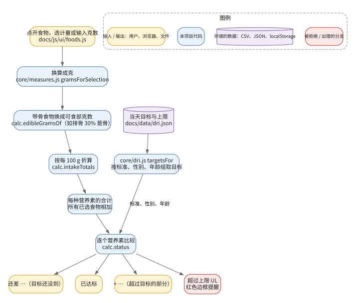
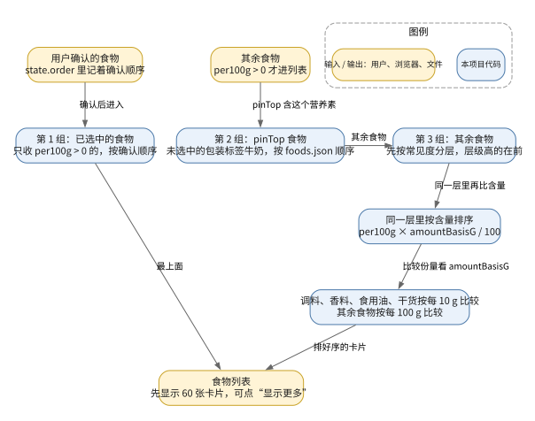

# 入门讲解：一次点击里的数字是怎么来的

这篇文档写给**没写过代码**的人。你不需要会编程，只要会用一个网页，就能跟着读完。
读完之后你会知道：网站上那些「还差 512 mg」是怎么算出来的、为什么数字不会凭空出现、
为什么这个网站没有服务器也能用。

遇到不认识的词，随时去 [`GLOSSARY.md`](GLOSSARY.md) 查；想看更细的技术说明，读
[`ARCHITECTURE.md`](ARCHITECTURE.md) 和 [`KEY_IMPLEMENTATION.md`](KEY_IMPLEMENTATION.md)。
这篇只讲「怎么回事」，不讲怎么写代码。

**图的颜色和图例是一致的**（下面两张图都带图例）：黄色 `#FFF4D6` / `#C9A227` 表示输入和输出
（你、你的浏览器、你看到的文件），蓝色 `#EAF2FB` / `#4A78A8` 表示本项目自己的代码，
绿色 `#E8F6EA` / `#3C8D4F` 表示外部来源（USDA、CNS / NASEM 表、GitHub Pages），
红色 `#FCE8E6` / `#C0392B` 表示被拒绝或出错的分支，紫色圆柱 `#F1ECF8` / `#7D5BA6`
表示存下来的数据（CSV、JSON、localStorage）。

---

## 一、先从一个日常问题开始：我今天钙够了吗？

你可能听过「多喝牛奶补钙」。可是「够」是多少？没人能凭感觉回答，所以官方给了**每日参考值**。
本站页面上一张张卡片里的「每日目标」，就是从官方表格里查出来的一个数字。

打个比方：把每天的钙想成往一个桶里倒水。

- 桶上画着一条线，写着「800 毫克」。这条线就是你的**每日目标**，也叫
  [`DRI`（膳食营养素参考摄入量）](GLOSSARY.md) 里的一种。
- 中国 2023 版表格给出的这个数，类型叫 [`RNI`（推荐摄入量）](GLOSSARY.md)：
  大多数同年龄、同性别的人，每天吃到这个量就够了。
- 桶口还有一圈「溢出口」，写着 2000 毫克。这是 [`UL`（可耐受最高摄入量）](GLOSSARY.md)：
  长期每天都超过它，才需要担心。本站的钙上限适用于普通食物，所以真的吃超了卡片会变红提醒。
- 有些营养素官方证据不足，算不出 RNI，就换成一个叫 [`AI`（适宜摄入量）](GLOSSARY.md) 的值。
  页面上数字后面会标出它是 RNI 还是 AI，例如「800 mg (RNI)」。

所以同一桶水，对不同的人画的线不一样。页面默认按「女性、30 岁、用中国标准」来画线，
你改性别、年龄或标准，线的位置就会跟着变。

这三个信息决定了查哪一张表、哪一行：按 [`年龄组`](GLOSSARY.md) 的划分，
30 岁女性落在 `cn-f-30-49` 这一组，钙的目标是 800 mg (RNI)，上限 2000 mg。
页面上那三个下拉框，就是用来改这三个信息的。

代码里查这一行的是 `docs/js/core/dri.js` 的 `findGroup()`：按性别和年龄找到对应的组，
再由同一个文件的 `targetsFor()` 把组里的 22 个数值交给页面。它们只做查找，从不自己编数字。

## 二、食物那边的数字从哪来：一张「每 100 克」的营养成分表

再看桶的另一半：你吃进去多少。

现实里你没法每顿饭都去化验，所以营养成分只能靠**查表**。就像超市包装背面的营养成分表，
它告诉你「每 100 克这个食物里含多少钙」。本站所有食物都用同一个基准：
**每 100 克**（[`per 100 g`](GLOSSARY.md)），存在 `docs/data/foods.json` 里，字段名就叫 `per100g`。

这个文件现在有 591 个食物：588 个来自美国农业部的
[`SR Legacy`](GLOSSARY.md) 数据集（2018-04 版），另外 3 个是包装标签牛奶——
这是用户自己家的三种牛奶，钙直接用包装上的数字，其他营养素参考同类食品（USDA）估算
（[`包装标签食物`](GLOSSARY.md)）。
每个食物都带 22 个营养素的值，分成 33 个中文分类（叶菜类、畜肉类、奶类……）。

三个小规矩，看一眼就懂：

- **`null` 表示「没这个数据」，不是「含量为零」。** 比如奶粉没有维生素 A 的数据，
  `per100g.vitA` 就是 `null`。算总量时它按 0 算，而且这个食物干脆不出现在维生素 A 的列表里——
  没有数据的东西不该参与排名（[`空值`](GLOSSARY.md)）。
- **写着的 `0` 才是「确实不含」。** 比如盒马零脂牛奶的 `per100g.vitC` 就是 `0`。
- **大部分食物按每 100 克比较，少数按每 10 克。** 调味料、香辛料、食用油和干货一次只吃一点点，
  用 100 克比没意义，所以它们的 [`比较基准`](GLOSSARY.md)（`amountBasisG`）是 10，
  这种食物现在有 58 个。营养数值永远按每 100 克存，只是排序比较时，调料和干货这类一次只吃一点的食物按每 10 克来比。

还有两类食物要特殊处理，后面会用到：

- **带骨的食物**（现在 15 个，例如猪排骨）。你称的是带骨头的整块，但营养只在肉里，
  所以要先换算成「可食部」——先把骨头扣掉，只算肉的重量（[`可食部`](GLOSSARY.md)）。
  `foods.json` 的 `refusePct` 记着骨头占多少（排骨是 30），代码就用它把带骨重量换成可食部再算。
- **包装标签食物**（3 个牛奶）。它们不在 USDA 表里，钙直接取包装上的数字，
  其余营养素参考同类 USDA 食物估算，卡片上带「包装标签」徽章（[`包装标签食物`](GLOSSARY.md)）。

---

## 三、一次点击怎么变成卡片上的数字



**图解：点一份食物只是选了一个重量，之后所有的数字都是「重量 × 每 100 g 含量 ÷ 100」再和目标相减。**

- 起点是食物卡片上的编辑框（`docs/js/ui/foods.js`）：你选一条家庭计量，比如「一杯」，
  或者自己填克数。确认后由 `docs/js/core/state.js` 的 `confirmFood()` 把
  「哪条计量、几份、一共多少克」记下来。
- `docs/js/core/measures.js` 的 `gramsForSelection()` 把「一杯」「一掌心」这类说法换成克数。
- 带骨食物先换成可食部：`docs/js/core/calc.js` 的 `edibleGramsOf()` 算
  「克数 ×（1 − 废弃率 ÷ 100）」。
- `docs/js/core/calc.js` 的 `intakeTotals()` 把所有已选食物加起来；`status()` 再和目标比，
  得出「还差 / 已达标 / +超出 / 超过上限」四种状态。

### 一步一步算给你看：25 g 奶粉 + 一杯牛奶

下面每个数字都能在 `docs/data/foods.json` 和 `docs/data/dri.json` 里查到，也能自己重算。
设定就是页面的默认档案：**女性、30 岁、中国 2023**（`cn-f-30-49` 组），钙目标 800 mg (RNI)。

**第一步：只点一杯奶粉。**

德运脱脂奶粉的 `per100g.calcium` 是 **1152**（毫克/每 100 克）。它的默认计量是
「一杯（25 g 奶粉冲 250 mL）」，也就是 25 克奶粉。它不是带骨食物，没有废弃率，直接乘：

```text
1152 mg/100 g × 25 g ÷ 100 = 288 mg
```

卡片就显示：**还差 800 − 288 = 512 mg**（页面上写作「还差 512 mg」）。

**第二步：再点一杯盒马零脂牛奶。**

盒马零脂牛奶的 `per100g.calcium` 是 **116.5**，默认计量「一杯（250 mL）」是 257.5 克：

```text
116.5 mg/100 g × 257.5 g ÷ 100 = 299.9875 mg
```

两个食物一起，`intakeTotals()` 把它们的贡献相加：

```text
288 + 299.9875 = 587.9875 mg
```

页面显示时按规则取整（大于等于 100 不留小数），587.9875 显示成 **588**；
目标减去合计，800 − 587.9875 = 212.0125，显示成 **212**。
所以钙卡片变成：**还差 212 mg**。

同一次点击里，其它营养素也各算各的：

| 营养素 | 奶粉贡献 | 牛奶贡献 | 合计 | 目标 | 卡片文字 |
|---|---|---|---|---|---|
| 钙 | 1152 × 25 ÷ 100 = 288 | 116.5 × 257.5 ÷ 100 = 299.9875 | 587.9875 → 588 | 800 mg (RNI) | 还差 212 mg |
| 铁 | 0.32 × 25 ÷ 100 = 0.08 | 0.03 × 257.5 ÷ 100 = 0.07725 | 0.15725 → 0.16 | 18 mg (RNI) | 还差 17.8 mg |
| 维生素C | 6.8 × 25 ÷ 100 = 1.7 | 0（确实不含） | 1.7 | 100 mg (RNI) | 还差 98.3 mg |

（奶粉的铁是 `per100g.iron` = 0.32，维生素 C 是 6.8；牛奶的铁是 0.03，维生素 C 是 0。
奶粉没有维生素 A 数据（`null`），所以维生素 A 标签页里根本不会出现这个奶粉，
维生素 A 卡片仍然是「还差 660 ug RAE」——这是 660 的目标值减去 0。）

**第三步：如果吃到带骨的东西，先去掉骨头。**

猪排骨（生）的 `per100g.calcium` 是 15，`refusePct` 是 30，意思是称 100 克排骨有 30 克是骨头。
所以先换算可食部，再乘：

```text
可食部 = 100 g ×（1 − 30 ÷ 100）= 70 g
钙     = 15 mg/100 g × 70 g ÷ 100 = 10.5 mg
```

这一步 `edibleGramsOf()` 做，卡片上会写「可食部约 70 g」提醒你。

**第四步：什么时候会变红？**

`status()` 除了算差多少，还会看有没有超过上限。钙的 `ul` 是 2000 mg，而且
`ulAppliesToFood` 是 `true`（这个上限适用于普通食物）。所以只要合计超过 2000 mg，
卡片就会出现红色提醒。反例是维生素 A：它的上限只针对补充剂，`ulAppliesToFood` 是 `false`，
吃食物再多也不会因为这条上限报警——这就是为什么那个字段必须写在数据里，而不是由代码猜。

还有两个容易被忽略的小细节：

- **差多少不会是负数。** 没到目标时写「还差 X」，超过了写「+X」，正好相等写「已达标」。
  卡片上永远不会出现减号，也不会出现「还差 0」这种傻话（很小的非零值显示成 `<0.01`）。
- **计算机算小数时偶尔会留下极小的尾巴，程序会把这些几乎相等的情况当成刚好相等，
  避免页面上出现奇怪的超长小数。** 差值和目标几乎相等时，代码用一个很小的阈值（`epsilon`）
  把它当成「刚好」，所以卡片不会冒出奇怪的长串小数；显示前也照上面的规则取整。

## 四、为什么列表是那个顺序



**图解：列表先放你确认过的食物，再放包装标签牛奶，剩下的先看常见度、同一档里再比含量。**

- **第一组：你选过的食物**，按确认的先后排，最早的在最上面。改数量不会让它挪位置，
  这样你刚点的东西不会突然跳走。
- **第二组：置顶食物。** 三个包装标签牛奶在 `foods.json` 里写了 `pinTop: ["calcium"]`
  （[`置顶食物`](GLOSSARY.md)），意思是「在钙标签页里排到普通食物前面」。
  所以打开钙标签页，前 3 张卡片就是德运脱脂奶粉、山姆部分脱脂牛奶、盒马零脂牛奶。
  一旦你选中其中一个，它就升到第一组去。
- **第三组：其余食物。** 先看[`常见度`](GLOSSARY.md)（1–5 档，档位越高越常见），
  同一档里再比含量，最后按中文名。常见度档位由 AI 模型估算、人工复核，写在 `data-src/commonness.csv`，
  不是官方分级——它的作用是让「豆腐」排在「某种进口罕见豆」前面。
- **只在含有这个营养素时才出现。** 值为 `null`、`0` 或干脆没有的食物，在这个标签页里不显示。
  所以奶粉不会出现在维生素 A 的列表里，哪怕它被置顶了也一样。
- **一次画 60 张卡片**（`DEFAULT_LIMIT`），点「显示更多（+60）」再加 60 张；
  已选和置顶的食物不受这个限制，永远在最上面。

这些规则都在 `docs/js/core/order.js` 的 `partitionFoods()` 里，函数把食物分成
「已选 / 置顶 / 其余」三组，再分别排好。

---

## 五、为什么数据要在自己电脑上先算好

你可能会想：这些数字为什么不在你打开网页时现算？为什么要先「构建」一遍？

打个比方：菜谱和采购单。**采购单**（原始数据）又大又乱，里面有七千多种食物，
大部分你一辈子不会吃；**菜谱**（网站用的数据）只留你需要的几百种，还按中文重新写好名字。
没有人会在炒菜的时候翻完整本采购单——太慢、太容易出错。所以有人提前把它整理成一本薄薄的菜谱。

这个项目就是这样：

- **原始数据**是美国农业部整理的一张很大的营养成分总表，里面有七千多种食物。
  这张总表太大、太杂，所以不会直接放进网站，而是提前从里面挑出几百种常用食物，
  整理成网站能直接读的小文件（技术名：USDA [`SR Legacy`](GLOSSARY.md) 数据集）。
  原始表格下载后放在 `data-raw/`，这个文件夹不进仓库（太大），也不会出现在网站上。
- **整理表**在 `data-src/` 里，是可以逐行复核的输入：收录哪些食物、中文名叫什么、
  一条「一杯」合多少克、常见度是几档、哪些是带骨食物、哪些按每 10 克比较、
  3 个包装标签牛奶的数值、以及两套参考摄入量 `data-src/dri/cn2023.csv` 和 `data-src/dri/us.csv`。
- **构建脚本**是 `tools/` 里的 Python 程序：
  `tools/build_foods.py` 读原始 CSV 和整理表，算出每个食物每 100 克的数值，写成 `docs/data/foods.json`；
  `tools/build_dri.py` 把两套参考值整理成 `docs/data/dri.json`。
  从头跑一遍的命令是 `npm run build:data`。
- **检查**由 `tools/validate_data.py` 做，命令 `npm run validate`。它逐项核对：
  列名对不对、数值范围合不合理、排序名单和带骨名单有没有漏、
  鱼类虾蟹贝类是不是都只收生食材、包装标签食物的钙有没有填、生成的 JSON 数量对不对。
  任何一项不合格，它就报错退出（`exit 1`），坏数据不会被提交，也就不会上网站。
  另外 `tools/check_values.py` 会从原始 CSV 重新抽查一批食物，看数值是否和 `foods.json` 一致。

这样做的好处很实在：

1. **网站变简单。** 浏览器只需要读三个小 JSON 文件，不用懂 USDA 的表格格式，也不用装任何东西。
2. **数字可追溯。** 每个值都能追到某一行 CSV；错一行，构建或检查就会报出来。
3. **官方数字不会被瞎改。** 参考摄入量只来自人填写的 `data-src/dri/*.csv`，脚本从不自己推算该填多少。
   食物数据里没有的值就写 `null`，绝不「凭记忆补一个」。

## 六、网页是怎么送到你面前的

这个网站没有后台服务器，也没有数据库和账号。它只是一堆**文件**：一个 HTML 页面、
一些样式、`docs/js/` 里的 JavaScript、`docs/data/` 里的三个 JSON，加上图标。
这种叫[`静态站点`](GLOSSARY.md)。

打比方：它像一本印好的书，不是需要厨师现做的餐厅。谁把书递给你都行，
所以托管方式可以很简单：

- **线上**：GitHub Pages 直接拿仓库的 `docs/` 文件夹当网站根目录发布，推上去一两分钟就更新。
  不需要打包、不需要编译、没有自动化流水线。这也是为什么新文档都放在顶层的
  `documentation/`——放进 `docs/` 就会跟着网站一起公开。
- **本地**：`npm run serve` 会用 Python 自带的功能，在 `http://localhost:8000/` 把 `docs/`
  当网站提供出来，看完按 Ctrl+C 关掉。为什么不能直接双击 `docs/index.html`？
  因为浏览器出于安全考虑，不允许用 `file://` 打开的页面去读取旁边的 JSON 文件，
  必须由一个「服务器」来提供文件。命令行里那个 Python 小服务器就是这个作用，它不是网站的一部分。

页面里所有的链接和数据请求都写**相对路径**（[`相对路径`](GLOSSARY.md)），
没有一个以 `/` 开头。所以网站放在 `https://host/` 也好，放在 `https://host/任意/子/路径/` 也好，都能正常工作。

你在页面上做的选择存在浏览器的 [`localStorage`](GLOSSARY.md) 里，就像记在自己的笔记本上：只留在这台设备，
不会上传。存的是选了哪些食物、各多少克、性别年龄、用哪套标准，键名 `mnt.state.v1`。
刷新后还在，换一台电脑就是一份新的空记录。
数据不会上传，因为根本没有服务器可以上传——这一点是设计出来的，不是省事。

## 七、测试怎么保护这些行为

改了数据或代码，怎么知道没把别的地方弄坏？靠测试。就像出门前检查门窗：不用重新装修一遍，
只要确认每个关键的地方还好好的。

项目里有两层测试，都不需要额外的构建步骤：

- **单元测试：`npm test`。** 命令是 `node --test "tests/unit/*.test.mjs"`，
  现在 15 个文件、257 个测试全部通过。它直接拿来 `docs/js/core/` 里的纯函数，
  喂进去小份的自造数据，检查算得对不对。例如：
  合计里 `null` 不算数、`0` 会保留键；带骨食物称 100 克只算 70 克；
  「还差」和「超出」不会同时大于 0；已选食物按确认顺序排在最前；
  详情里 0 和 `null` 都不出行。`tests/unit/data.test.mjs` 还会读真实的
  `docs/data/foods.json`，核对固定的数值、常见度、哪些按每 10 克比较、
  3 个牛奶的钙（1152、126.2、116.5），以及 `docs/` 下没有不该出现的说明文字。
- **浏览器测试：`npx playwright test`。** Playwright 开着真的浏览器，像人一样点按钮、填数字。
  现在 2 个文件、24 个测试。它不讲内部逻辑，只确认界面上的结果，比如钙标签页前三张卡片
  是不是那三个牛奶、确认一杯奶粉后钙是不是加了 288 mg。如果哪天有人改坏了页面，
  测试会直接失败，而不是等用户发现。

平时改完东西，至少跑一遍 `npm test`；如果动了 `docs/` 里的页面、样式或 JSON，
再加上 `npx playwright test`。改了数据就先 `npm run build:data`、`npm run validate`，
确认都通过再一起提交。

## 八、读完这篇之后

想看每个词的意思：随时打开术语表（[`GLOSSARY.md`](GLOSSARY.md)）。遇到不认识的词直接查就行，不用从头再读一遍。

想继续深入，可以按兴趣挑：

- 想看整体结构、文件夹、每个数据字段：[`ARCHITECTURE.md`](ARCHITECTURE.md)
- 想看具体算法和代码片段：[`KEY_IMPLEMENTATION.md`](KEY_IMPLEMENTATION.md)
- 想自己跑起来、跑测试、重新生成数据：[`../README.md`](../README.md)
- 想知道线上怎么自检：[`../DEPLOY.md`](../DEPLOY.md)
