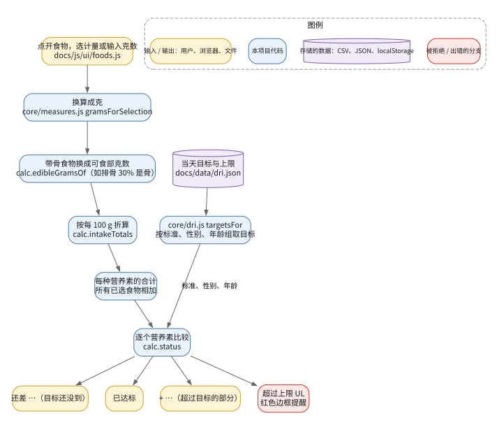
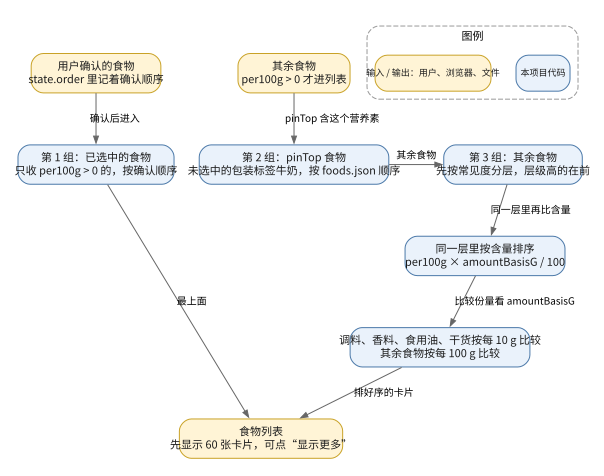

# 关键实现

这篇文档讲几个真正决定页面数字的地方：当天目标怎么查、吃下去的克数怎么变成合计和卡片状态、
家庭计量和带骨食物怎么换算、食物列表怎么排、详情里的营养素怎么排，以及数据在离线构建时守了哪些规矩。
想先看整体结构，读 [`ARCHITECTURE.md`](ARCHITECTURE.md)；遇到不认识的词，查 [`GLOSSARY.md`](GLOSSARY.md)。

这里只写代码现在做的事。每一段代码都是从文件里原样摘出来的，行数不超过 15 行，
上面一行写着文件路径和函数名，想核对就打开那个文件看。

**图的颜色和图例是一致的**：黄色 `#FFF4D6` / `#C9A227` 表示输入和输出（用户、浏览器、你看到的文件），
蓝色 `#EAF2FB` / `#4A78A8` 表示本项目自己的代码，绿色 `#E8F6EA` / `#3C8D4F` 表示外部来源
（USDA、CNS / NASEM 表、GitHub Pages），红色 `#FCE8E6` / `#C0392B` 表示被拒绝或出错的分支，
紫色圆柱 `#F1ECF8` / `#7D5BA6` 表示存下来的数据（CSV、JSON、localStorage）。
两张图都由 `documentation/diagrams/build.mjs` 生成，改了图要运行 `npm run docs:diagrams`。

本文会用到的几个词：

| 术语 | 英文全称 | 中文 | 在本项目里 |
|---|---|---|---|
| 目标值 | target | 每日目标 | `docs/data/dri.json` 每格里的 `target`，由 `docs/js/core/dri.js` 的 `targetsFor()` 取出。 |
| 上限 | UL, Tolerable Upper Intake Level | 可耐受最高摄入量 | 同一格里的 `ul`；只有 `ulAppliesToFood` 为真时，超过才在卡片上提醒。 |
| 可食部 | edible portion | 去掉骨头等不可食部分后的重量 | `docs/js/core/measures.js` 的 `edibleGrams()` 用「带骨克数 ×（1 − 废弃率）」算出来。 |
| 常见度 | commonness tier | 日常常见程度 1–5 档 | `docs/data/foods.json` 每个食物的 `commonness`，列表排序先看它。 |
| 比较份量 | amount basis | 比较用的份量 | `docs/data/foods.json` 的 `amountBasisG`，只有 10 和 100 两种；58 个食物按 10 g 比较，其余按 100 g。 |

## 一、一次点击怎么变成卡片上的数字



**图解：点一份食物只是选了一个重量，后面所有的数字都是「重量 × 每 100 g 含量」再和目标比。**

- 起点是 `docs/js/ui/foods.js` 的编辑框：用户选一条家庭计量（如「一杯」）或直接填克数，
  确认后 `docs/js/core/state.js` 的 `confirmFood()` 把 `{ measureId, count, grams }` 存进 `selections`。
- `docs/js/core/measures.js` 的 `gramsForSelection()` 负责把选择变成克数。
- 带骨食物（现在 15 个，`refusePct` 有值）先由 `docs/js/core/calc.js` 的 `edibleGramsOf()` 换成可食部克数，
  例如排骨 30% 是骨，称 100 g 只算 70 g。
- `docs/js/core/calc.js` 的 `intakeTotals()` 把每份食物的「每 100 g 含量 × 可食部克数 ÷ 100」加总；
  `status()` 再拿合计和 `targetsFor()` 给出的目标比，得出「还差 / 已达标 / +超出 / 超过上限」。

### 当天目标怎么查：`docs/js/core/dri.js`

`docs/js/core/dri.js` 导出的函数只有三个：`clampAge()`、`findGroup()`、`targetsFor()`。

- 站点只覆盖成年人：`MIN_AGE` 是 18，`MAX_AGE` 是 100，`clampAge()` 把任何年龄夹在这个范围里，
  传入乱七八糟的值（比如存档被改坏）时回到 18，不会抛错。
- `findGroup()` 只在同一性别、同一生活阶段（现在只有 `"none"`）的分组里找，
  年龄落在 `ageMin` 到 `ageMax` 之间就返回那一组；`ageMax` 是 `null` 表示不封顶
  （中国 75 岁以上、美国 71 岁以上）。
- `targetsFor()` 把整套 `docs/data/dri.json`、标准名（`cn2023` 或 `us`）和
  `{ sex, age, lifeStage }` 收进来，返回 `{ standard, group, values, unitIds }`。
  找不到匹配的分组时 `values` 是空对象，卡片就显示「无参考值」，不会变绿。

`docs/js/core/dri.js` 的 `findGroup()`：

```js
  const value = clampAge(age);
  for (const group of groups) {
    if (!group || group.sex !== sex) continue;
    if ((group.lifeStage || DEFAULT_LIFE_STAGE) !== DEFAULT_LIFE_STAGE) continue;
    const min = Number(group.ageMin);
    const max = group.ageMax === null || group.ageMax === undefined ? Infinity : Number(group.ageMax);
    if (!Number.isFinite(min)) continue;
    if (value >= min && value <= max) return group;
  }
  return null;
```

### 合计和卡片状态：`docs/js/core/calc.js`

`docs/js/core/calc.js` 是纯函数，不碰页面，也不 import 别的模块，所以 `node --test` 能直接加载它。
它导出的主要函数：

| 函数 | 做什么 |
|---|---|
| `selectionGrams(selection)` | 取一条选择里存下的克数，不是正数就算 0。 |
| `refusePctOf(food)` | 取废弃率，缺失或不在 0–100 之间时算 0。 |
| `edibleGramsOf(food, selection)` | 可食部克数 = 克数 ×（1 − 废弃率 ÷ 100）。 |
| `intakeTotals(selections, foodsById)` | 所有已选食物的每种营养素合计。 |
| `status(target, intake, ul, ulAppliesToFood)` | 比较合计和目标，给出 `remaining`、`surplus`、`met`、`overUL`。 |
| `formatNumber` / `formatAmount` / `formatSurplus` / `cardText` / `nutrientSummary` | 把数字和状态变成卡片上的中文。 |

合计的算法很直白：遍历每条选择，跳过重量为 0 的，再遍历这个食物 `per100g` 里的每个营养素。
`null` 表示原始表里没有这个值，直接跳过；写着的 0 表示「这种食物确实不含它」，
会保证这个键存在（合计里记 0），但不会加任何数。

`docs/js/core/calc.js` 的 `intakeTotals()`：

```js
    for (const [nutrientId, per100g] of Object.entries(food.per100g)) {
      if (per100g === null || per100g === undefined) continue;
      const value = Number(per100g);
      if (!Number.isFinite(value) || value === 0) {
        // A zero still proves the nutrient is known for this food, so make
        // sure the key exists without adding anything.
        if (!(nutrientId in totals)) totals[nutrientId] = 0;
        continue;
      }
      totals[nutrientId] = finiteOrZero(totals[nutrientId]) + (value * grams) / 100;
    }
```

`status()` 有几个刻意的细节，都能从返回值里看到：

- `remaining` 和 `surplus` 都不会是负数，正好达标时两个都是 0。
- 浮点误差会被抹平：差值和目标的差距小于一个很小的 `epsilon` 就算「刚好」，
  所以卡片不会冒出「+0.00000000000000006」这种字样。
- `overUL` 只在 `ulAppliesToFood` 为真且合计真的超过 `ul` 时才为真：
  只针对补充剂的上限不会因为吃食物而报警。
- `ratio` 是合计除以目标，目标卡片用它画进度条（画的时候夹在 0 到 100% 之间）。

`docs/js/core/calc.js` 的 `status()` 末尾：

```js
  return {
    hasTarget: true,
    target: targetValue,
    intake: value,
    remaining: !met && diff > 0 ? diff : 0,
    surplus: met && !exact && diff < 0 ? -diff : 0,
    met: met || exact,
    overUL: Boolean(ulAppliesToFood) && ulValue !== null && value > ulValue,
    ul: ulValue,
    ratio: targetValue > 0 ? value / targetValue : met ? 1 : 0,
  };
```

卡片文字由 `cardText()` 决定，四种情况一一对应：没有目标写「无参考值」，没达标写「还差 X 单位」，
超过目标写「+X 单位」，正好写「已达标」。数字的写法由 `formatNumber()` 定：
大于等于 100 不留小数，大于等于 10 留一位，其余留两位并去掉末尾的 0；
很小但不为 0 的值写成 `<0.01`，不会显示成 0。整段文字里不会出现减号。

## 二、家庭计量和带骨食物的克数

`docs/js/core/measures.js` 只做一件事：把「一杯」「一个」「一掌心」这类说法换成克，
并把带骨食物的两种重量分开。

- 一条计量的数据形状是 `{ id, labelZh, grams, basis, default }`，`grams` 是这条计量合多少克。
- 选择下拉框除了食物自己的计量，还会多一条手填的「克」：它的 id 是常量 `GRAMS_MEASURE_ID`（值为 `"grams"`），
  不是一个真实的数据行，所以 `findMeasure()` 对它返回 `null`。
- `measuresOf()` 过滤掉克数不是正数的行；`defaultMeasure()` 取标了 `default: true` 的那条，
  没有就取第一条；`measureOptions()` 生成下拉框的选项；`stepCount()` 每次加减 `COUNT_STEP`（0.5）。
- 克数统一用 `roundGrams()` 保留一位小数（0.1 g），把浮点噪声挡在外面。

`gramsForSelection()` 的规则是「手填克数优先」：选择里只要有有限的 `grams`，就用它；
否则才用「份数 × 计量克数」。手填 0 是一个有效答案（这份就是 0 g），不会退回去用计量。

`docs/js/core/measures.js` 的 `gramsForSelection()`：

```js
export function gramsForSelection(food, selection) {
  if (!selection || typeof selection !== "object") return 0;

  const raw = selection.grams;
  if (raw !== null && raw !== undefined) {
    const grams = Number(raw);
    if (Number.isFinite(grams)) return roundGrams(grams);
  }
  if (typeof selection.measureId === "string" && selection.measureId !== GRAMS_MEASURE_ID) {
    return gramsFromMeasure(food, selection.measureId, selection.count);
  }
  return 0;
}
```

带骨食物（`docs/data/foods.json` 里有 `refusePct` 的 15 个）多一层换算：家庭计量和手填的克数都是
**带骨重量**，而 USDA 的含量是每 100 g **可食部**的数值，所以乘含量之前要先换成可食部克数。
`edibleFactor()` 返回 `1 - refusePct/100`，普通食物没有 `refusePct`，系数正好是 1，行为不变。
编辑框和卡片上那句「带骨重量 · 可食部约 70 g」里，前半段来自常量 `WITH_BONE_LABEL`，
后半段由 `formatEdibleGrams()` 生成。

`docs/js/core/measures.js` 的 `edibleGrams()`：

```js
export function edibleGrams(food, grams) {
  return roundGrams(roundGrams(grams) * edibleFactor(food));
}
```

`docs/js/core/calc.js` 里有一份同样规则的 `refusePctOf()` / `edibleGramsOf()`。
这是有意重复的：`calc.js` 不 import 任何模块，所以 `node --test` 加载它时不需要整张模块图。

## 三、食物列表怎么排：`docs/js/core/order.js`



**图解：列表先放你确认过的食物，再放包装标签牛奶，剩下的先看常见度、同一档里再比含量。**

- `docs/js/core/order.js` 的 `partitionFoods()` 把食物分成三组：`pinned`（已选）、
  `leading`（未选中的 `pinTop` 食物）、`unpinned`（其余要排序的）。
- 只有**含有**这个营养素的食物才进列表：`per100g[n]` 是 0、`null` 或干脆没有这个键，
  在对应的营养素标签页里既不置顶也不显示，不管有没有选中。
- 已选组按确认顺序排（存档里的 `order`，最早的在前），新确认的加在最后；
  改数量不会挪位置。老存档没有 `order` 时，`selectionOrder()` 按 `selections` 的键顺序补出来。
- `leading` 组是 `pinTop` 里列了这个营养素的未选食物，按 `foods.json` 的顺序：
  现在就是 3 个包装标签牛奶，`pinTop` 是 `["calcium"]`，所以它们在钙标签页排在最前面。
  一旦选中，就进入上面的已选组。
- `unpinned` 组先按 `commonness` 从高到低（5 档最常见），同一档里再按含量从高到低，最后按中文名。
  没有常见度的食物当 0 档，排在所有有档的食物后面。
- 含量不是每 100 g 的值，而是「比较份量」里的值：`richnessOf()` 算的是
  `per100g[n] × amountBasisG / 100`。调料、香料、食用油和干货的 `amountBasisG` 是 10，
  所以按每 10 g 比；其余食物是 100。层数仍然先决定顺序，按 10 g 比较的食物不会因此跳到更高一档的前面。

`docs/js/core/order.js` 的 `partitionFoods()` 里给已选组挑食物的一段：

```js
  for (const foodId of selectionOrder(picked, order)) {
    const food = byId.get(foodId);
    if (!food) continue;
    const per100g = valueOf(food, nutrientId);
    // 0, null and missing all mean "this food does not contain the nutrient":
    // not listed in this tab at all, selected or not (P16).
    if (per100g === null || per100g <= 0) continue;
    pinned.push({
      ...food,
      selected: true,
      contribution: (per100g * edibleGramsOf(food, picked[foodId])) / 100,
    });
  }
```

`docs/js/core/order.js` 的 `partitionFoods()` 里给其余食物排序的比较函数：

```js
  unpinned.sort((a, b) => {
    // Commonness first (P18b): an everyday food outranks a niche one even when
    // the niche food is far richer in the nutrient. Only inside one tier does
    // the richness decide (P19b: the per-10 g comparison for condiments and
    // dried goods, per 100 g otherwise), then the Chinese name.
    const byCommonness = desc(commonnessOf(a), commonnessOf(b));
    if (byCommonness !== 0) return byCommonness;
    const byRichness = desc(richnessOf(a, nutrientId), richnessOf(b, nutrientId));
    return byRichness !== 0 ? byRichness : byName(a, b);
  });
```

几处配套的小规矩：

- `DEFAULT_LIMIT` 是 60，`LIMIT_STEP` 也是 60：一次画 60 张卡片，点「显示更多（+60）」再画 60 张。
  这个上限只算 `unpinned` 组，已选和 `leading` 的食物永远在最上面，不会被「显示更多」挡住。
  `hasMore()` 就是数剩下的 `unpinned` 还有没有超过上限。
- 搜索框有内容时，三组都按中文名、英文名和别名过滤，符合条件的已选和 `leading` 食物仍在最前面。
- 卡片上的含量标签：`docs/js/ui/foods.js` 的 `amountText()` 用
  `per100g × amountBasisG / 100` 算显示值，`basisLabel()` 按 `amountBasisG` 是 10 还是 100
  返回「每 10 g」或「每 100 g」。营养素的值本身从不被改动，改的只是显示的份量。
- `isPackageLabel()` 判断 `source.type === "package_label"`，卡片和详情页据此加「包装标签」徽章，
  一眼能和 USDA 数据分开。

## 四、详情里的营养素怎么排：`docs/js/core/detail.js`

「查看详情」弹窗的行由 `detailRows(food, targets, nutrients, grams)` 生成。
它读一个食物的 `per100g`、当前档案的目标、`docs/data/nutrients.json` 的 22 个营养素，
以及编辑框里选的克数，每个真正含有（大于 0）的营养素给出一行。

- 每行有 `per100g`（每 100 g 含量）、`pct100`（每 100 g 占目标的百分比）、
  `amount` 和 `pct`（所选份量下的含量和百分比）；编辑框里没填克数时后两个是 `null`。
- 带骨食物同样先换成可食部克数，规则和总量合计完全一样。
- 只给食物真正含有的营养素出行：值正好是 0 和值是 `null` 的都不显示，
  所以维生素 D 为 0 的食物在详情里没有这一行，整个食物没有任何数值时页面显示「暂无营养素数据」。
- 排序在 `sortDetailRows()` 里：先是有值又有目标的（按占目标百分比从高到低），
  再是有值但没有目标的（按每 100 g 含量从高到低），`zero` 和 `missing` 两组排在最后
  （这两组在 P23 之后不会被 `detailRows()` 交进来，函数本身仍然认得它们）。
  排序是稳定的，数值相同的行保持 `docs/data/nutrients.json` 里的顺序，和标签页、目标卡片一致。

`docs/js/core/detail.js` 的 `sortDetailRows()`：

```js
export function sortDetailRows(rows) {
  const list = Array.isArray(rows) ? rows.filter(Boolean) : [];
  // The filters keep the input (nutrients.json) order; Array#sort is stable,
  // so equal values keep that order too.
  const ranked = list.filter((row) => row.status === "ok");
  const untargeted = list.filter((row) => row.status === "noTarget");
  const zero = list.filter((row) => row.status === "zero");
  const missing = list.filter((row) => row.status === "missing");
  ranked.sort((a, b) => b.pct100 - a.pct100);
  untargeted.sort((a, b) => b.per100g - a.per100g);
  return [...ranked, ...untargeted, ...zero, ...missing];
}
```

百分比文字由 `formatPct()` 负责：没有百分比写「—」，大于 0 但不到 1% 写「<1%」，
小于 10% 留一位小数，大于等于 10% 取整。有限的 0 仍然写「0%」，这样「没有」和「没数据」不会看起来一样。

## 五、数据构建时守的规矩：`tools/build_foods.py`

`tools/build_foods.py` 把原始 CSV 和 `data-src/` 里的整理表合成 `docs/data/foods.json`。
它不重新测营养素，只做整理、换算和取舍：

- **数值只有一个来源。** 每 100 g 的含量从 USDA SR Legacy（2018-04）的 CSV 读出来，
  用 `round_sig()` 四舍五入到最多 4 位有效数字（`SIGNIFICANT_DIGITS` 是 4），不增加精度。
- **烟酸按 NE 算。** `nutrient_value()` 里烟酸的算法是「烟酸 mg + 色氨酸 g × 1000 ÷ 60」，
  除数是 `NIACIN_NE_DIVISOR`（60.0）。色氨酸缺失时只用烟酸本身，并把 `flags.niacinNoTryptophan` 记成 `true`。
- **缺少计量有兜底。** `data-src/measures.csv` 里没有的食物会用 `DEFAULT_MEASURE`（「100克」，100 g），
  页面上任何时候都有一条可用的默认计量。
- **常见度只留整数。** `load_commonness()` 从 `data-src/commonness.csv` 读 1–5 的整数，
  只把这个整数写进 `foods.json` 的 `commonness`；CSV 里的 `reason_zh` 是复核用的，一个食物缺档位就让构建失败。
- **每 10 g 名单。** `data-src/small_portion_foods.csv` 现在列了 58 个食物（调料、香料、食用油和干货），
  在名单里的 `amountBasisG` 写 10，其余写 100。名单里出现不存在的食物编号同样让构建失败。
- **带骨食物。** `data-src/bone_in_foods.csv` 现在 15 行，构建时写进 `refusePct`（废弃率）
  和一句 `refuseNote`（例如「按带骨重量计，可食部约 70%（USDA 废弃率 30%：骨）」）；每 100 g 的数值不动，换算交给浏览器。
- **包装标签食物。** `data-src/custom_foods.csv` 现在 3 行牛奶。钙用标签上的数值，
  其余微量营养素按 `base_fdc_id` 指的同类 USDA 食物算，`null_nutrients` 里的几项设回 `null`；
  `fdcId` 和 `usdaDescription` 都是 `null`，`source` 里只公开类型、基础食物编号和估算的营养素清单，
  中文的来源说明只留在 `data-src/`。
- **顺序稳定。** 最后按 `fdcId` 排 SR Legacy 食物，3 个包装标签食物没有 `fdcId`，按 CSV 顺序接在最后。

`tools/build_foods.py` 的 `load_custom_foods()` 里定钙和估算清单的一段：

```py
        per100g, flags = nutrient_values(nutrient_meta, amounts_by_food.get(base_fdc_id, {}))
        per100g["calcium"] = round_sig(calcium)
        for nutrient_id in null_nutrients:
            per100g[nutrient_id] = None

        estimated = [
            nutrient_id
            for nutrient_id in nutrient_ids
            if nutrient_id != "calcium" and nutrient_id not in null_nutrients
        ]
```

`tools/build_foods.py` 的 `build()` 里给每个食物定比较份量的一段：

```py
    for food in foods:
        food["amountBasisG"] = (
            SMALL_PORTION_BASIS_G if food["id"] in small_portions else DEFAULT_AMOUNT_BASIS_G
        )
```

现在生成出来的 `docs/data/foods.json` 有 591 个食物：588 个来自 SR Legacy，3 个来自包装标签；
其中 33 个分类、58 个按 10 g 比较、15 个带骨，家庭计量一共 1092 条。
`docs/data/meta.json` 的 `counts` 也记着食物数、SR Legacy 数、包装标签数、带骨食物数和营养素数，方便核对。

### 只收生食材、不收录菜肴

这几条是数据取舍，不是营养素计算：

- **没有菜肴估算。** `data-src/` 下原来的菜肴估算表已经删除，`data-src/foods_curated.csv` 和
  `docs/data/*.json` 里都没有 `composite:` 开头的编号，也没有菜肴名。
- **肉类只要生食材。** 畜肉类、禽肉类、内脏类和加工肉制品里，中文名带「熟 / 烤 / 炖 / 煮 / 炒 / 煎」或
  英文名带 cooked / roasted 等词的行不允许出现。
- **蛋类只要生的。** 每个蛋类食物的中文名必须带「生」，中文名和英文名都不许出现
  熟 / 煮 / 煎 / 炒 / 烤 / 蒸 / 荷包 / 炖 这些字，USDA 描述里也不许出现 cooked / fried / scrambled 等词。
- **鱼和海鲜只要生的。** 鱼类、虾蟹类、贝类三个分类同样必须有「生」，并且不许出现
  熟 / 蒸 / 煮 / 烤 / 煎 / 炸 / 罐装 / 腌 / 干 / 熏。海藻类不受这条限制，紫菜（生）和琼脂（干）都还在。

`tools/validate_data.py` 的 `validate_raw_meat()` 摘录（蛋类和海鲜的检查函数写在旁边，
规则一样，只是词表不同）：

```py
        name_zh = (row.get("name_zh") or "").strip()
        name_en = (row.get("name_en") or "").strip().lower()
        label = f"foods_curated.csv line {line_no} ({row.get('fdc_id')})"
        zh_hits = [word for word in COOKED_NAME_WORDS_ZH if word in name_zh]
        en_hits = [word for word in COOKED_NAME_WORDS_EN if word in name_en]
```

## 六、校验脚本查什么：`tools/validate_data.py`

`tools/validate_data.py` 是数据提交前的门卫：任何一项不合格就打印问题清单并 `exit 1`，
坏数据进不了仓库，也就上不了网站。`main()` 依次调用下面这些检查，全部通过时打印每项的 OK 行：

| 检查函数 | 查什么 |
|---|---|
| `validate_nutrients()` | `data-src/nutrients.csv` 的 22 个营养素：编号、单位、USDA 编号、卡片颜色的对比度。 |
| `validate_foods()` | `data-src/foods_curated.csv` 每行都能在 SR Legacy 里找到，编号不重复，中英文名和分类都不为空，USDA 分类没落在被排除的几类里。 |
| `validate_measures_csv()` | 每个食物至少一条计量、恰好一条默认，每条计量的克数和依据（`usda_portion:` / `estimate:` / `label:`）都合法；带骨食物的计量标签以「（带骨）」结尾，普通食物不许带；`label:` 开头的依据只用于包装标签食物。 |
| `validate_raw_meat()` / `validate_raw_eggs()` / `validate_raw_seafood()` | 上面那三条「只要生食材」的规矩。 |
| `validate_no_composites()` | 原来的菜肴估算表必须已经删除，没有任何 `composite:` 编号，也没有菜肴名。 |
| `validate_commonness_csv()` | 每个食物的常见度是 1–5 的整数，编号不重复；随后由 `validate_commonness_json()` 和 `foods.json` 双向核对。 |
| `validate_small_portion_csv()` | 每 10 g 名单里的编号都真实存在。 |
| `validate_custom_foods_csv()` | 包装标签行的 `source`、`base_fdc_id`、钙数值、`null_nutrients`、`pin_top` 是否合法。 |
| `validate_no_reason_leak()` | 扫一遍 `docs/` 下的文本：常见度理由和来源说明一个字都不许出现，`docs/data/*.json` 里也不许有 `reason` 键。 |
| `validate_generated_json()` | 生成的 `foods.json`、`nutrients.json`、`meta.json` 的结构、数量、字段；带骨食物和 `amountBasisG` 单独再查一遍，JSON 里也不许出现绝对 URL 路径。 |

其中 `validate_amount_basis()` 确认每个食物的 `amountBasisG` 只能是 10 或 100，
而且名单里的食物必须是 10、不在名单里的必须是 100。

`tools/check_values.py` 是另一条独立的抽查：它不 import 构建脚本，自己重新读原始 CSV，
随机抽若干 SR Legacy 食物，把 22 个营养素逐个和 `docs/data/foods.json` 比，
允许 0.1% 的舍入误差。它只抽有 `fdcId` 的食物，包装标签食物不在抽查范围内。

## 七、测试怎么保护这些行为

测试分两层，都不需要构建步骤：

- **单元测试：`npm test`。** 命令是 `node --test "tests/unit/*.test.mjs"`，现在 15 个文件、
  257 个测试全部通过。它们直接 `import` `docs/js/core/` 里的纯函数，
  用小份的自造数据（fixture）检查边界情况，例如：合计里 `null` 不算数、0 会保留键；
  带骨食物 100 g 只算 70 g；`remaining` 和 `surplus` 不会同时大于 0；
  已选食物按确认顺序排在最前；`per100g` 为 0 的食物在别的标签页不出现；
  详情里 0 和 `null` 都没有行。`tests/unit/data.test.mjs` 还会读真实的 `docs/data/*.json`，
  核对固定数值、常见度、`amountBasisG`、包装标签牛奶的钙，以及 `docs/` 下没有理由文字。
- **浏览器测试：`npx playwright test`。** 现在 2 个文件、24 个测试，用系统 Chrome
  打开真的页面跑真的事件。`tests/e2e/helpers.mjs` 明确不 import `docs/` 里的模块，
  全部通过点击、输入、选择走界面流程，这样站点里某个模块坏掉时测试不会跟着一起错。
  `tests/e2e/screens.spec.mjs` 的 4 个测试还顺便把桌面 1440、手机 390 和详情弹窗的截图写进 `shots/`。
- **跑之前本机要能起静态服务器。** 没设 `BASE_URL` 时，`playwright.config.mjs` 会自己起两个
  `python3 -m http.server`：一个把 `docs/` 当站点根目录，另一个把仓库根目录当根目录，
  用来验证站点放在子路径下也能用。

改完代码或数据，至少跑一遍 `npm test`；动了 `docs/` 里的页面、样式或 JSON，再加上
`npx playwright test`。改了数据就先 `npm run build:data`、`npm run validate`，
确认生成和校验都通过，再一起提交。

## 八、想看更多

- 整体结构和每个文件夹：[`ARCHITECTURE.md`](ARCHITECTURE.md)
- 术语：DRI、RNI、AI、UL、RAE、NE、DFE、常见度、包装标签：[`GLOSSARY.md`](GLOSSARY.md)
- 写给没写过代码的人，用真实数字走一遍：[`EXPLAINED.md`](EXPLAINED.md)
- 怎么发布、线上怎么自检：[`../DEPLOY.md`](../DEPLOY.md)
